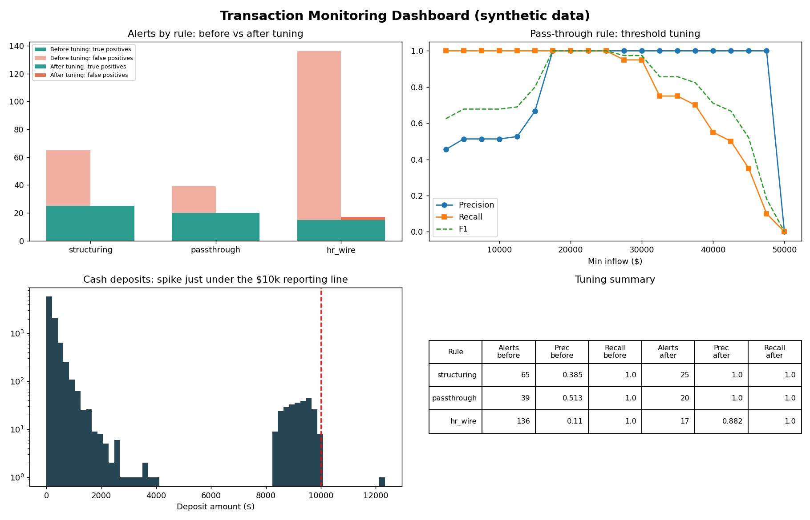

# AML Transaction Monitoring

A Python and SQL project for detecting suspicious financial transactions, tuning AML detection rules, and visualizing results.


## Project Overview

This project simulates an Anti-Money Laundering (AML) transaction monitoring workflow using approximately 75,000 synthetic transactions across 3,000 accounts.

The objective is to identify potentially suspicious financial activity, evaluate detection rules, and reduce unnecessary alerts through threshold tuning.

## Technologies Used

- Python
- Pandas and NumPy
- SQL
- Matplotlib
- Data Visualization
- Precision, Recall, and F1 Evaluation

## Detection Scenarios

1. **Structuring:** Detecting repeated deposits over a short period.
2. **Rapid Pass-Through:** Identifying accounts receiving and quickly transferring funds.
3. **High-Risk Wires:** Detecting transactions involving simulated high-risk jurisdictions.

## Results

| Detection Rule | Alerts Before | Alerts After | Precision After | Recall After |
|---|---:|---:|---:|---:|
| Structuring | 65 | 25 | 100% | 100% |
| Rapid Pass-Through | 39 | 20 | 100% | 100% |
| High-Risk Wires | 136 | 17 | 88% | 100% |

**Key Result:** Reduced total simulated alert volume from 240 to 62 (approximately 74%) while maintaining detection of the injected suspicious patterns.

## How to Run

Install dependencies:

```bash
pip install -r requirements.txt
```

Run the script:

```bash
python aml_monitoring.py
```

## Limitations

The project uses synthetic transactions and injected suspicious activity labels. Results are not representative of real-world AML system performance. Real-world deployment would require additional validation and investigation.

## Future Improvements

- Test with publicly available AML datasets.
- Add automated tests and separate validation data.
- Develop customer risk scoring.
- Explore sanctions name screening using fuzzy matching.
- Build an interactive dashboard.

## Development Note

This project was developed with assistance from AI coding tools as an educational exploration of Python, SQL, transaction monitoring, and rule optimization.

## Disclaimer

This is an educational portfolio project, not a production AML compliance system.
